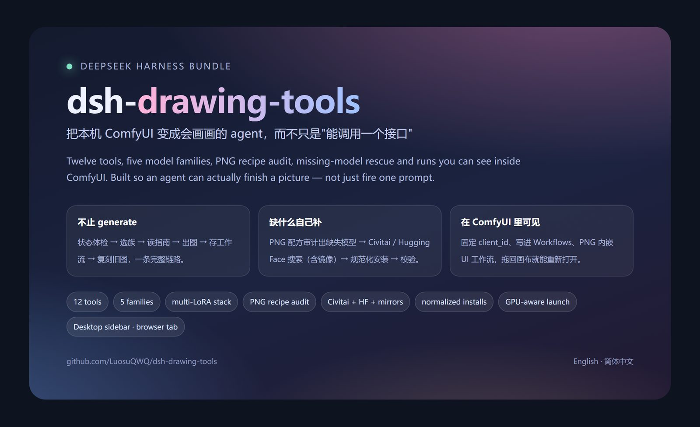
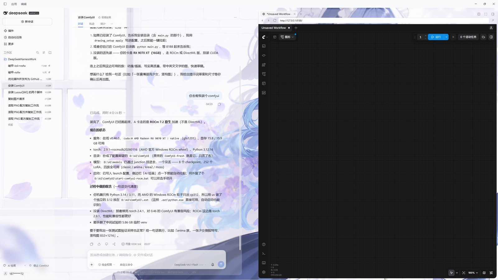
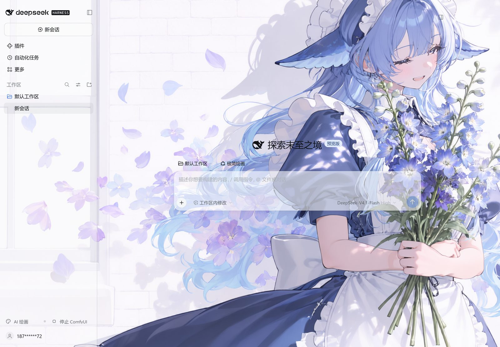
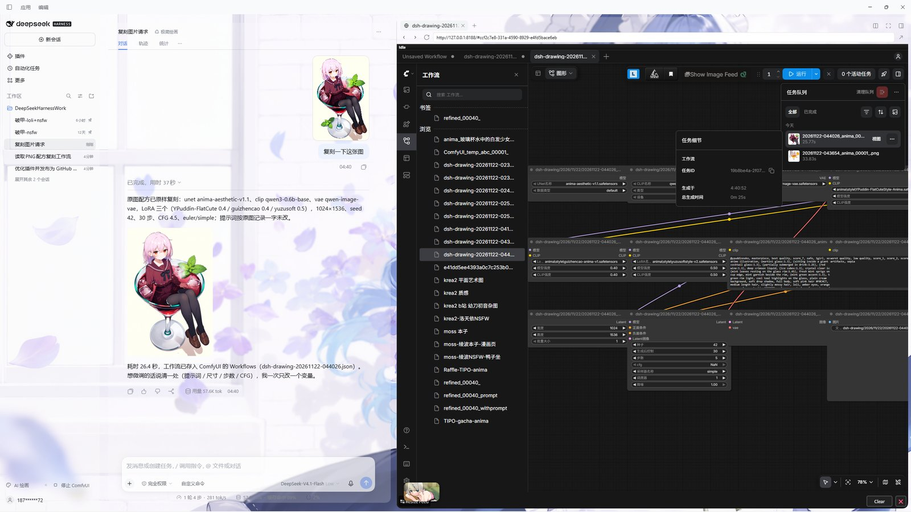

English | [简体中文](README.zh-CN.md)

# HuiJianRong

> Local AI image generation for DeepSeek Harness through a ComfyUI server.

DeepSeek Harness (DSH) has no built-in image generation. This bundle adds twelve `drawing_*` tools that drive a local ComfyUI instance over its HTTP API, and a sidebar entry that opens the ComfyUI canvas in the right sidebar (Desktop) or in a new browser tab (web). The tools can report server status, list the models that are actually installed, read a per-family prompt guide, generate batch or img2img images, inspect the queue and history, run saved workflows, and recover the recipe from a ComfyUI PNG. It is displayed as **Drawing tools** in English and **绘画工具** in Chinese.

Installing this single bundle gives you all three pieces: the twelve tools, the sidebar entry, and the **Minimal drawing (极简绘画)** agent preset (preset id `drawing-minimal`), which shows up in the new-session preset list. You do not need a second package for the preset.



## Why this plugin

Most ComfyUI bridges give the model one `generate` call and leave everything else to you. This bundle is built for a machine it has never seen, and for a picture you actually want to finish.

| | dsh-drawing-tools | a typical ComfyUI bridge |
| --- | --- | --- |
| Model knowledge | five family guides with real sizes, steps and CFG, captured trigger words and per-family defaults | the model guesses |
| Missing files | reads the PNG recipe, searches Civitai / Hugging Face (with mirrors), installs normalized names, verifies the hash | generation just fails |
| Reproducibility | every run's UI workflow is written into ComfyUI and embedded in the PNG | a one-off graph |
| Portability | no preset paths; adopts the paths ComfyUI reports; detects the GPU and the launch command | hardcoded paths |
| Recovery | reads an old ComfyUI PNG and rebuilds the graph | start from scratch |

## Quick start / 快速开始

**What it is (EN).** A DeepSeek Harness bundle that turns a local ComfyUI into a drawing agent. One install gives you twelve `drawing_` tools, a sidebar entry that opens the ComfyUI canvas, and the **Minimal drawing (极简绘画)** agent preset. It talks only to your own ComfyUI over HTTP; no cloud service, no bundled models.

**这是什么（中文）。** 一个把本机 ComfyUI 变成绘画 agent 的 DeepSeek Harness 插件包。装一次同时得到 12 个 `drawing_` 工具、一个打开 ComfyUI 画布的侧边栏入口，以及 **极简绘画** agent 预设。它只通过 HTTP 访问你自己的 ComfyUI，不含任何模型、不上传任何数据。

**Install (EN).**
1. Install ComfyUI (any GPU; `drawing_status` tells you which build and launch flags fit your card) and start it, default `http://127.0.0.1:8188`. No models? `drawing_download` can search Civitai / Hugging Face and install them.
2. Add the bundle to a DSH profile — Desktop: **Settings → Plugins** and install this repository; CLI:
   ```sh
   git clone https://github.com/LuosuQWQ/dsh-drawing-tools.git
   dsh plugin --profile <profile> add link:<absolute-path>/dsh-drawing-tools
   ```
3. Restart DSH (bundles load at startup), open a new session, choose **极简绘画 / Minimal drawing**.
4. Say what to draw. First check: `drawing_status`; if ComfyUI is installed but not configured for auto-start, `drawing_setup({ action: 'detect' })` / `apply` fixes it.

**安装（中文）。**
1. 装好 ComfyUI（任意显卡；`drawing_status` 会告诉你该用哪种构建和启动参数）并启动，默认 `http://127.0.0.1:8188`。没有模型时 `drawing_download` 可以从 Civitai / Hugging Face 搜索并安装。
2. 把 bundle 加进一个 DSH profile——桌面版：**设置 → 插件** 里安装本仓库；命令行：
   ```sh
   git clone https://github.com/LuosuQWQ/dsh-drawing-tools.git
   dsh plugin --profile <profile> add link:<本地绝对路径>/dsh-drawing-tools
   ```
3. **重启 DSH**（bundle 在启动时加载），新建会话选 **极简绘画 / Minimal drawing**。
4. 直接描述画面。先跑 `drawing_status`；ComfyUI 装了但没配自动启动时，用 `drawing_setup({ action: 'detect' })` / `apply` 修好。

The built-in family guides are Chinese because the agent reads them; an English index of what each one covers is in [guides/README.en.md](guides/README.en.md).

> **First run, please read.** After the bundle is installed, restart DSH and open a new session; choose the **极简绘画 / Minimal drawing** preset. That preset is the installer: it inspects the machine, tells you which ComfyUI build fits the GPU, and with your permission downloads/installs ComfyUI and wires the launch command. When it asks for full permissions, grant them for that session — without them it cannot write outside the workspace or start the server. If an agent is doing this for you, it must tell you first, then report every step and the result.



**For agents.** Read [AGENTS.md](AGENTS.md) for the machine-actionable contract: tool list, config keys, credential names, path rules and verification steps.

## Opening the canvas — every case

The sidebar entry is the same in every deployment, but how the canvas appears depends on where DSH runs:

| Situation | What happens |
| --- | --- |
| Desktop app | opens a native browser tab in DSH's right sidebar |
| DSH opened in a plain browser | opens the ComfyUI origin in a new browser tab (there is no right sidebar to fill) |
| Right sidebar exists but no session surface is mounted | retries the sidebar, then falls back to a new tab instead of failing |
| Browser blocks the new tab | a toast explains that popups were blocked; allow them and retry |
| ComfyUI is not running | the entry starts it (from `launch` config or detection), then opens the canvas |
| ComfyUI is not on 8188, or is remote | set `config.origin` (or `COMFY_ORIGIN`); the canvas and every tool follow it |
| ComfyUI is not installed | `drawing_status` explains what to install and which build fits the GPU |

## Screenshots



**1** The **极简绘画 / Minimal drawing** preset: twelve `drawing_` tools, no editor or web tools, and a persona that only draws on an explicit request. **2** The **AI 绘画** entry above Settings: it shows the ComfyUI state, can stop the server, and opens the canvas; a toast reports the mode.



**3** Replicating a PNG recipe in the desktop client: the agent reads the embedded workflow, keeps the model, sampler and stacked LoRAs, replaces the original random prompt with a fixed one, re-runs it, and saves the new graph to ComfyUI's Workflows list. The right sidebar shows the saved graph with its `LoraLoader` chain.


**4** A result reproduced from a PNG whose recipe stacks several style LoRAs (anima-aesthetic-v1.1 + `luotianyi` / `guizhencao` / `yuzusoftstyle` / `YPuddin-FlatCute` at 0.4–0.9), 1024×1536 — the recipe travels with the file, so the picture can be rebuilt exactly.

## Features

- Twelve `drawing_*` tools: status, model inventory, family guide, generation (batch, img2img, LoRA), queue control, history, saved workflows, and PNG recipe inspection.
- Multiple LoRAs per image: pass an array and each one becomes a LoraLoader in order (MODEL and CLIP both chained), with per-LoRA model/clip strength.
- Every run is visible in ComfyUI: it is submitted with client id `dsh-drawing-tools`, a UI-format workflow is written to ComfyUI's Workflows list, and the same workflow is embedded in the PNG so dragging the image back onto the canvas opens the graph.
- Four model families (classic, anima, krea2, moss) with per-family defaults for steps, CFG, sampler, and scheduler.
- Bundled usage guides per family: prompt syntax, resolutions, text layout, and known pitfalls, readable through `drawing_guide` — plus a prompt template library with nine tested recipes, negative-prompt packs and a family cheat sheet.
- A sidebar entry above Settings that starts ComfyUI when needed and opens the canvas: in the Desktop app it opens as a native tab in the right sidebar, and when DSH is opened in a plain browser (no right sidebar) it opens a new browser tab instead.
- Model documentation: `drawing_modeldoc` fetches a model's official card/guide from Hugging Face or Civitai (or imports a local `.md`) into `<models>/.dsh-docs/<kind>/<slug>/` with a provenance index, and `drawing_guide({ model })` returns it before falling back to the family guide. Installs capture the source docs automatically.
- Every model file reports a `usage` field: the exact call that draws with it (`classic` for checkpoints, its own family for the four known ones, `generic` plus companions for anything else).
- Missing-model recovery: `drawing_download` searches Civitai, installs the file into the right ComfyUI folder, verifies SHA256 and reports where it landed — with the token held by the host, never by the prompt.
- The **Minimal drawing (极简绘画)** agent preset: the official `minimal` tool table plus the twelve `drawing_*` tools, and nothing else (no shell on Windows beyond `pwsh`, no web, todo, jobs, or file editing).
- Recipe recovery from chat images: the original PNG's ComfyUI chunks are captured on upload, so `drawing_pnginfo` can answer from the message's `sha256` even after the file is gone.
- One-command start/stop of a locally installed ComfyUI, with logs and a pid file kept in a folder you choose.

## Starting ComfyUI

The sidebar entry and the `/start` route launch ComfyUI through the bundle row's `launch` config. When that config is empty the host detects a launch automatically: it takes the ComfyUI root from the configured `comfyRoot`, `COMFYUI_HOME`, the reported `models` folder's parent, or a few common portable locations, and looks for `main.py` plus an interpreter (`.ext/python.exe`, `python_embeded`, `venv`, `.venv`). `drawing_status` reports which source it used.

If detection fails (unusual layout), `drawing_setup({ action: 'detect' })` shows the candidate roots and why it failed, and `drawing_setup({ action: 'apply', comfyDir: '<ComfyUI folder>' })` writes `command`/`args`/`cwd` into the host row. Explicit `launch` config always wins over detection.

## GPU and ComfyUI builds

The bundle never assumes CUDA. `drawing_status` detects the local GPU (vendor, name, VRAM) and prints the build and launch arguments that fit it, so a user who does not know ROCm from CUDA still gets a working setup:

| GPU | Build | Typical extra arguments |
| --- | --- | --- |
| NVIDIA | CUDA (the official portable build ships this) | `--use-pytorch-cross-attention` |
| AMD (Windows) | ROCm build (preferred) or DirectML build | `--use-quad-cross-attention`; only the DirectML build takes `--directml` |
| AMD (Linux) | ROCm | `--use-quad-cross-attention` |
| Intel | IPEX (experimental) | `--use-ipex` |
| Apple Silicon | official macOS build | MPS is automatic |
| none | CPU | `--cpu` (very slow) |

VRAM affects the advice too: below 6 GB it suggests `--lowvram`, below 2 GB `--novram`. `scripts/start-comfyui.ps1` applies the same per-vendor arguments automatically (pass `-ExtraArgs` to override, `-Cpu` for CPU). If ComfyUI is running on the CPU, `drawing_status` says so explicitly.

## Requirements

- DeepSeek Harness 0.2.x (developed against 0.2.2-rc.5).
- A running ComfyUI server with its HTTP API reachable, by default at `http://127.0.0.1:8188`.
- ComfyUI model files for the families you intend to use. No models are bundled; `drawing_models` lists what your installation actually exposes.
- Inline display uses DSH's own rendering: a Markdown image whose destination is a percent-encoded local path is served through the authenticated file route, and `drawing_generate` returns that line for every image. No extra image plugin is required.
- Windows for the bundled launcher and the stop route, which use `tasklist`, `netstat`, and `taskkill`. The tools themselves only speak HTTP.

## Install

This is a DSH bundle. Install it with the `plugin_manager` tool:

```json
{ "action": "install_bundle", "target": "<path-to-checkout>" }
```

Alternatively, add it to the profile's `package.json` (the profile directory is `$env:DSH_PROFILE_DIR` on Windows) and install there:

```json
{
  "dependencies": {
    "dsh-drawing-tools": "file:<path-to-checkout>"
  }
}
```

```bash
pnpm install
```

Installation applies to the whole profile. Restart DSH after changing this package's JavaScript: by default the profile's hot reload only reloads configuration, so a running session keeps the modules it loaded at startup.

**One bundle gives you ten tools, the "Minimal drawing" (极简绘画) agent preset and the sidebar entry.** The tools are exported as `dsh-drawing-tools/tools` and appear only in a preset that references that row; the preset shipped here references it for you (preset id `drawing-minimal`). The `dsh-drawing-minimal` package is deprecated and kept only as a compatibility placeholder.

## Configuration

The bundle inserts one Host row, `drawing-console`, which serves the sidebar entry. Override it in the profile patch:

```yaml
- id: drawing-console
  name: dsh-drawing-tools
  config:
    origin: http://127.0.0.1:8188
    launch:
      enabled: true
      command: <comfyui-root>/.ext/python.exe
      args: [<comfyui-root>/main.py, --force-fp32]
      cwd: <comfyui-root>
      logDir: <path-for-logs>
      timeoutMs: 90000
```

| Field | Type | Default | Description |
| --- | --- | --- | --- |
| `origin` | string | `http://127.0.0.1:8188` | ComfyUI API base URL used by the sidebar entry and its status probe. |
| `launch.enabled` | boolean | Auto | Auto-start is on only when a launch command and a working directory are available. Set `false` to disable it explicitly. |
| `launch.command` | string | `COMFYUI_PYTHON`, else empty | Python executable used to start ComfyUI. |
| `launch.args` | string[] | `COMFYUI_MAIN`, else empty | Arguments passed to `main.py`. The built-in form adds `--preview-method auto`. |
| `launch.cwd` | string | `COMFYUI_HOME`, else empty | ComfyUI working directory. |
| `launch.logDir` | string | `COMFYUI_LOG_DIR`, else a temporary folder | Directory for `comfyui-<timestamp>.log` and `comfyui.pid`. |
| `launch.timeoutMs` | number | `90000` | How long a start waits for the port to answer before reporting a timeout. |

The bundle ships the launch paths empty, so auto-start stays off until you provide them. Set the three environment variables (`COMFYUI_PYTHON`, `COMFYUI_MAIN`, `COMFYUI_HOME`) for the DSH process, or fill in the row fields; then clicking the sidebar entry starts ComfyUI. Without a launcher, set `launch.enabled: false` and start ComfyUI outside DSH.

The tools read their own options from the row that mounts them (`drawing-tools` in the preset):

| Field | Type | Default | Description |
| --- | --- | --- | --- |
| `origin` | string | `COMFY_ORIGIN`, else `http://127.0.0.1:8188` | ComfyUI API base URL. |
| `comfyRoot` | string | ComfyUI's runtime report | ComfyUI install directory; workflow folders derive from it. The reported value always wins, and this field is only an offline fallback (environment variables no longer feed it). |
| `modelsRoot` | string | ComfyUI's runtime report | Models tree used for file sizes and target hints. The reported value always wins; this field is only an offline fallback (environment variables no longer feed it). |
| `outputDir` | string | Built-in path | Where generated PNGs and their `.json` sidecars are written. |
| `apiWorkflowsDir` | string | `<comfyRoot>/api-workflows` | API-format graphs that `drawing_workflow` lists and runs. |
| `uiWorkflowsDir` | string | `<comfyRoot>/user/default/workflows` | Where `drawing_pnginfo` saves UI-format graphs for ComfyUI's Workflows panel. |
| `timeoutSeconds` | number | `600` | Default generation wait, clamped to 30–3600. |

Like the launcher paths, the built-in defaults for `comfyRoot`, `modelsRoot`, and `outputDir` describe one local layout; set them explicitly on a new machine.

## Model sources and install rules

A workflow read from a PNG is audited before anything is downloaded: `drawing_pnginfo` reports the workflow format, the node inventory (each node type and its count) and every model file the graph references, each marked installed, missing, or unknown when ComfyUI is offline.

Missing files are resolved through **`drawing_download`**, whose sources and install rules are fixed:

| Step | What it does |
| --- | --- |
| `action: "search"` | Queries Civitai (public JSON API) and Hugging Face (model API) together; `source` limits it to one. Civitai results carry version id, file name, size and SHA256; HF results carry the repo id, downloads and likes. |
| `action: "files"` | Lists the model files inside one HF repo, with sizes and LFS SHA256. |
| `action: "find"` | Generic web search through DSH's web service. Links only — nothing is downloaded automatically from an arbitrary site. |
| `action: "download"` | Installs one file with the rules below. |

Every result reports each host attempt in order, failures included (`huggingface.co ✗ fetch failed → hf-mirror.com ✓`), and a failing host never stops the search.

Two hosts back each source: Civitai tries `civitai.com` and then `civitai.red`; Hugging Face tries `huggingface.co` and then `hf-mirror.com`. A switch happens only on a network failure or 5xx — a 401/403 is a credential problem and is reported instead of retried elsewhere.

Install rules (all enforced in code, not prose):

How a file is used afterwards, by kind: a **checkpoint** draws through `classic` (any SD1.5/SDXL/Pony checkpoint works with `CheckpointLoaderSimple`); a **LoRA** is added to any family through the `lora` parameter; a **VAE** or **text encoder** is a part, not a model on its own; and any other **diffusion model** draws through `family: 'generic'`, which requires you to name the `textEncoder` and `vae` explicitly (`.gguf` automatically uses the GGUF loader). `drawing_models` states this per file in its `usage` field, and `drawing_download` repeats it right after an install.

- **Folder by kind**: `lora`→`loras`, `checkpoint`→`checkpoints`, `diffusion_model`→`diffusion_models`, `vae`→`vae`, `text_encoder`→`text_encoders`, `controlnet`→`controlnet`, `embedding`→`embeddings`, `upscale_model`→`upscale_models`, `clip_vision`→`clip_vision`. The root comes from ComfyUI's own folder report or `config.modelsRoot`; it is never guessed.
- **Extra model roots**: when `extra_model_paths.yaml` spreads models over several directories, file sizes and LoRA matching walk every reported directory; installs still land in that kind's primary folder.
- **File names** keep their readable form (Chinese, spaces, dots) but lose any path component, control characters and characters Windows forbids; a missing model extension is added for the kind. The name is truncated at 120 characters so Windows path limits hold.
- **No overwrite**: an existing non-empty file of the same name is reported and skipped; a name collision during install becomes `name-2.safetensors`.
- **Atomic**: the download lands in `.part` and is renamed only after the SHA256 check passes. A failed or cancelled download deletes its partial file.
- **Metadata**: a Civitai install records the version's `trainedWords`, `triggerAlternatives` (author-written `a | b` alternatives), `triggerHints` (trigger instructions found in the model card), `baseModel`, tags, model name and page URL; a Hugging Face install records the repo's tags, pipeline and `instance_prompt` when present. A multi-word set is meant to be used together; an alternatives entry is a choice of one; a hint is the author's own usage note. `drawing_models` shows them per file, `drawing_pnginfo` attaches them to the files a recipe needs, and the download result repeats the trigger words so they are not lost. Without a trigger word the family guide's prompt rules apply.
- **Provenance**: each install writes `<models>/.dsh-install/<folder>/<file>.json` with source, URL (token redacted), kind, SHA256, byte count and timestamp, so a model can be traced or removed later.
- **Credentials**: Civitai uses `CIVITAI_TOKEN`, Hugging Face uses `HF_TOKEN`, both through DSH's credential store with an environment fallback. No tool parameter accepts a token.

## Replication fixture

`test/fixtures/anima-cam-recipe.png` is ComfyUI's **original output file** (1024×1536, sha256 `2bb77d7f…`), byte-for-byte, with the `prompt` text chunk exactly as exported. Use it to test the "look at an image → read the recipe → reproduce it" path. Note: images pasted into chat are re-encoded to JPEG by the client, so only reading this file by path gives you the full metadata.


```js
// 1. Read the recipe: models / three style LoRAs / seed / steps / CFG / size
drawing_pnginfo({ path: 'test/fixtures/anima-cam-recipe.png' })
// 2. Install whatever is missing (the result lists `missing`)
drawing_download({ action: 'search', query: '<missing LoRA name>', kind: 'lora' })
// 3. Generate with the original recipe
drawing_generate({ family: 'anima', model: 'anima-aesthetic-v1.1.safetensors', prompt: '...', lora: [...], seed: 11111, steps: 30, cfg: 4.5, width: 1024, height: 1536 })
```

It needs `anima-aesthetic-v1.1` + `qwen3-0.6b-base` + `qwen-image-vae` and three style LoRAs (YPuddin 0.4 / guizhencao 0.5 / yuzusoft 0.6). When a file is absent, `drawing_pnginfo` lists it under `missing` and `drawing_generate` names the exact one.

## Civitai credentials

`drawing_download` needs a token only for models that require a login (and for searches Civitai refuses anonymously). The token is never configuration and never reaches the model:

- Save it once in **Settings → AI 绘画**: the panel writes it into DSH's credential store under the reference `CIVITAI_TOKEN`. The value travels host-to-host, is never echoed back, and later reads report only "configured / source / masked".
- Or set the environment variable `CIVITAI_TOKEN` and restart DSH. A stored value outranks the environment, exactly as DSH's credential rules state.
- An older install that kept a plaintext `~/.dsh/civitai_token` is not read directly; the panel offers **从旧文件导入** once, and leaves the file for you to delete.
- No tool parameter accepts a token. Do not paste one into a prompt: it would become part of the conversation. Errors are redacted (`token=***`, `Bearer ***`) before they reach the model.
- The token is sent only to the official hosts (`civitai.com` / `huggingface.co`). Mirrors such as `civitai.red` or `hf-mirror.com` never receive it; if a mirror then answers 401, the error says the token was deliberately withheld instead of asking you to re-enter it.

## Output layout and path rules

Generated images follow one canonical layout under `outputDir`:

```
<outputDir>/<YYYY>/<MM>/<DD>/<HHMMSS>_<family>_<model-slug>_s<seed>_<nn>.png
<outputDir>/<YYYY>/<MM>/<DD>/<same name>.png.json
<outputDir>/index.jsonl
```

- The name is readable and sortable, contains the family, a slug of the model, the seed and the batch index. Existing files are never overwritten: a collision becomes `-2`.
- Every image gets a sidecar JSON with the full recipe, and one line is appended to `index.jsonl` at the root, so all generations are searchable in one place.
- `outputDir` is normalized: `~` is expanded, relative paths resolve against the working directory, trailing separators are dropped.
- ComfyUI keeps its own copy under `<comfy output>/dsh-drawing/<YYYY>/<MM>/<DD>/`, so its output folder stays grouped by date instead of flat.
- Older images stay where they were written; only new runs use this layout.

Paths that ComfyUI reports at runtime (`/internal/folder_paths`) win over configuration, which is what makes a moved or freshly installed ComfyUI work without editing config. `drawing_status` prints the reconciled paths and warns on a mismatch; `drawing_paths({ action: 'adopt' })` writes the real values back.

## Path conventions

- **Input paths** are resolved against the session directory, which the plugin reads from DSH's own `workingDirectory` service (falling back to the session header). Relative paths therefore mean "relative to where this conversation works".
- **Resource names are separate parameters.** A local file and a ComfyUI-side name never share a field: `initImage` is a path and `initImageName` is a name already inside ComfyUI's input folder; `drawing_workflow` takes `path` or `name`; `drawing_pnginfo` takes `sha256`, `name` or `path`. Passing two of them is an error rather than a silent precedence rule, and a path that does not exist fails instead of being retried as a name.
- **Outputs are absolute paths.** Generated PNGs land in `outputDir`; saved recipes land under ComfyUI's own workflow folders. Both are written with exclusive creation, so a concurrent save becomes `name-2.json` instead of overwriting.
- **Name lookups stay local by default.** `drawing_pnginfo({ name })` searches the output folder, the session directory and ComfyUI's `input`/`temp`; add `searchUserDirs: true` to also search `~/Desktop` and `~/Downloads`.
- **This is not a sandbox.** The host half reads any local path it is handed (that is how img2img and recipe reading work), so only point it at files you are willing to read.

## Usage

### Tools

| Tool | What it does | Key parameters |
| --- | --- | --- |
| `drawing_status` | Reports whether ComfyUI is online, its version, free and total VRAM, queue depth, and the models available per family. | none |
| `drawing_models` | Lists the model files ComfyUI can actually load, with family, size, and recommended sampler settings. | `kind`: `checkpoints`, `diffusion_models`, `text_encoders`, `vae`, `loras` |
| `drawing_guide` | Returns the usage guide for one family: prompt format, resolutions, text layout, parameters, pitfalls; `family: "prompt-patterns"` returns the template library instead. Without `family` it returns the index. | `family` |
| `drawing_generate` | Generates one or more images, or an img2img edit, with optional LoRA. Writes PNGs to the output folder and returns absolute paths. | `prompt`, `family`, `model`, `width`, `height`, `steps`, `cfg`, `sampler`, `scheduler`, `seed`, `batch`, `lora`, `initImage`, `initImageName`, `textEncoder`, `vae`, `clipType`, `denoise`, `timeoutSeconds` |
| `drawing_queue` | Shows the queue, interrupts the running job, or clears jobs that have not started. | `action`: `status`, `interrupt`, `clear` |
| `drawing_history` | Returns recent finished generations with the local path of each image. | `limit` (1–50, default 10) |
| `drawing_workflow` | Lists or runs API-format workflow graphs from the `api-workflows` folder. | `action`: `list`, `run`; `name`, `path`, `timeoutSeconds` |
| `drawing_setup` | Detects a ComfyUI installation and its Python (`detect`), or writes the result into the bundle row's `launch` config (`apply`) so the sidebar entry and start route can boot ComfyUI. | `action`, `comfyDir`, `python` |
| `drawing_modeldoc` | Fetches (`fetch`), imports (`import`), shows (`show`) or lists (`list`) official model documentation stored under `<models>/.dsh-docs`; `drawing_guide({ model })` reads it. | `action`, `model`, `kind`, `repo`, `versionId`, `path` |
| `drawing_paths` | Compares configured paths with the ones ComfyUI reports at runtime, flags mismatches and missing folders, and (with `adopt`) writes the real values back into the plugin config. | `action` |
| `drawing_download` | Finds and installs a model: `search` (Civitai + Hugging Face), `files` (list a HF repo), `find` (generic web search, links only), `download` (normalized install). The token stays in the host's credential store. | `action`, `source`, `query`, `kind`, `type`, `nsfw`, `limit`, `repo`, `file`, `revision`, `modelVersionId`, `downloadUrl`, `fileName`, `sha256` |
| `drawing_pnginfo` | Reads the ComfyUI recipe from a PNG: models, LoRAs, seed, steps, CFG, sampler, and both prompts. | `sha256`, `name`, `path`, `save`, `searchUserDirs` |

### Model families

| Family | Model kind | Defaults (steps / CFG / sampler / scheduler) | Good for |
| --- | --- | --- | --- |
| `classic` | SD 1.5 checkpoint | 25 / 7 / `euler` / `normal` | Fast drafts and a general fallback. |
| `anima` | Anima 2B with its own text encoder and VAE | 30 / 4 / `euler` / `simple` | Anime, illustration, characters. Turbo variants drop to 8 steps and CFG 1. |
| `krea2` | Krea-2 Turbo 12B (GGUF) | 8 / 1 / `euler` / `simple` | Photoreal, cinematic, heavy stylization; the slowest of the four. |
| `moss` | MOSS-Image 5B | 25 / 2.5 / `er_sde` / `simple` | Accurate Chinese and English text layout, posters, diagrams. |

Passing no `steps`, `cfg`, `sampler`, `scheduler`, or `width` uses the family defaults. `drawing_models` reports the values that apply to a specific file, and `drawing_guide` explains how to prompt for that family; when a guide and a tool result disagree, the tool result wins.

A minimal generation call:

```json
{
  "name": "drawing_generate",
  "arguments": {
    "prompt": "a red fox sitting in a snowy forest at dusk, soft rim light, detailed fur, cinematic",
    "family": "anima",
    "width": 768,
    "height": 768,
    "seed": 11
  }
}
```

Each image lands in `outputDir` under a date folder, with a sibling `.json` holding the parameters and the ComfyUI `promptId`.

### Sidebar entry

The entry appears at the bottom of the left sidebar, directly above Settings, and is labelled **AI drawing** (English) or **AI 绘画** (Chinese). Its status dot is green when ComfyUI is running, grey when it is not, and amber while a start is in progress; the status is polled every 12 seconds and stops while the page is hidden. Clicking the entry probes the server, starts it when needed, and opens the canvas in a native browser tab in the right sidebar. A second row, **Stop ComfyUI**, appears only while the server is online and stops it to free VRAM.

## How it works

The tools are plain Node code that talks to ComfyUI over HTTP: `/object_info` for the model inventory, `/system_stats` and `/queue` for status, `/prompt` to submit a graph, `/history/<id>` to poll, `/view` to download results, and `/upload/image` for img2img inputs. A workflow graph is built per family and submitted as ComfyUI's API-format `prompt`; the results are written to disk, never embedded in the model's context.

The Host half serves config, status, start, stop, and log routes for the sidebar entry, and wraps the attachments service's image-save methods. Before DSH normalizes an uploaded image into a metadata-free copy, it stores the PNG's `prompt`, `workflow`, and `parameters` text blocks under the normalized attachment id (`sha256:…`) in `<DSH_HOME>/drawing-pnginfo/`. That is why `drawing_pnginfo` needs no path for an image sent in chat.

## Limitations

- Workflow files must be in ComfyUI's API format. Graphs exported from the UI editor are rejected; use **Export (API)** and save into `api-workflows`.
- No models, LoRAs, embeddings, or upscale models are shipped. Missing files have to be installed into ComfyUI before generating.
- One generation at a time is the safe pattern; batch above 1 and large resolutions can exhaust VRAM.
- The automatic start and stop paths are Windows-specific, and stop only targets the pid recorded by this bundle or a `python.exe` listening on the configured port.
- Recipe capture only covers images uploaded after the bundle is active. Older files, screenshots, and re-encoded images carry no ComfyUI metadata.
- The tool descriptions and the per-family guides are written in Chinese; the English README documents the same behavior but the text a model reads at runtime is Chinese.

## Running on another machine

Nothing in this package assumes this author's disk layout or GPU. What it does assume is that **some** ComfyUI answers at the configured origin.

1. **Install and start ComfyUI yourself** (any directory, any vendor). The plugin ships no default install or models path, so it never points at a directory you do not have; it reads the real one once ComfyUI answers. It must listen on `127.0.0.1:8188`, or you change `origin` — in the plugin row config or via `COMFY_ORIGIN`. Windows can use `scripts/start-comfyui.ps1`; macOS/Linux can use `scripts/start-comfyui.sh`, or just `python main.py`.
2. **Ask for a health check**: `drawing_status` reports the version, device, VRAM, where the model directories came from, whether auto-start is configured, and which families have files. When ComfyUI is unreachable it says what is missing and how to fix it instead of failing obscurely.
3. **Add models for the family you want**, then draw.

No ComfyUI or model path is preset. Resolution is: explicit config/env first, then the running ComfyUI's own folder table (`/internal/folder_paths`, cached for a minute), and otherwise **unknown** — there is no default path to be wrong about. `drawing_status` says which source was used; an unknown path only costs file sizes, local image lookup and recipe saving, never generation.

| Missing | What still works | What degrades |
| --- | --- | --- |
| No ComfyUI at `origin` | `drawing_guide`, `drawing_models` stays empty, `drawing_status` explains the gap | every generation / queue / history / workflow call |
| No `comfyRoot` / `modelsRoot` configured and ComfyUI cannot report them | model listing (names come from ComfyUI) | file sizes, local image lookup under ComfyUI's `input`/`temp`, recipe saving into ComfyUI folders |
| No `launch` configured | opening the ComfyUI canvas from the sidebar | auto-starting ComfyUI |
| Older ComfyUI without `/internal/folder_paths` | everything over HTTP | automatic path discovery (set the paths explicitly) |

Model names are not hardcoded into the call path: omitting `model` picks the first file this machine actually has for that family, and a missing text encoder or VAE is reported with the directory it belongs in.

## Development

Install the dev dependencies once (they are only needed for the offline tests):

```sh
npm install
```

`npm test` runs the four offline suites below. Everything else is a standalone script run with Node from the package directory, and needs a live ComfyUI:

```bash
node test/package-contract.mjs # offline: client module id, exports and slot registrations match the package
node test/offline-contract.mjs # offline: tool definitions, families, guide reachability and a clean manifest
node test/guides.mjs          # offline: per-family guides are readable and complete
node test/pnginfo.mjs         # offline: PNG recipe parsing and capture lookup
node test/capture.mjs         # offline: Host capture hook against the installed Cordis build
node test/check-connection.mjs    # live ComfyUI: status and model inventory
node test/tools-smoke.mjs         # live ComfyUI: all twelve tools end to end
node test/generate.mjs anima      # live ComfyUI: one image, family classic|anima|krea2|moss
node test/smoke-extras.mjs        # live ComfyUI: batch, img2img, queue, history, workflows
node test/timeout-interrupt.mjs   # live ComfyUI: timeout returns a promptId, then interrupt
node test/verify-variants.mjs     # live ComfyUI: family variant defaults
```

Tests that need a server read `COMFY_ORIGIN` and default to `http://127.0.0.1:8188`. `npm test` runs only the offline suites (package contract, offline contract, guides, PNG recipes).

## License

MIT. See [LICENSE](LICENSE).

