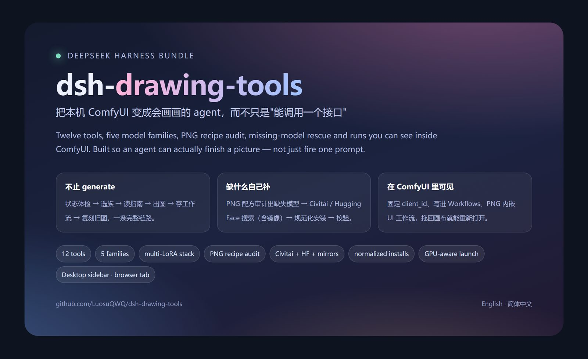
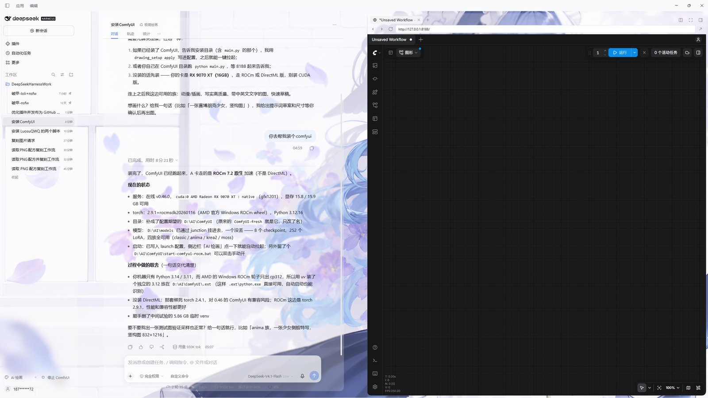
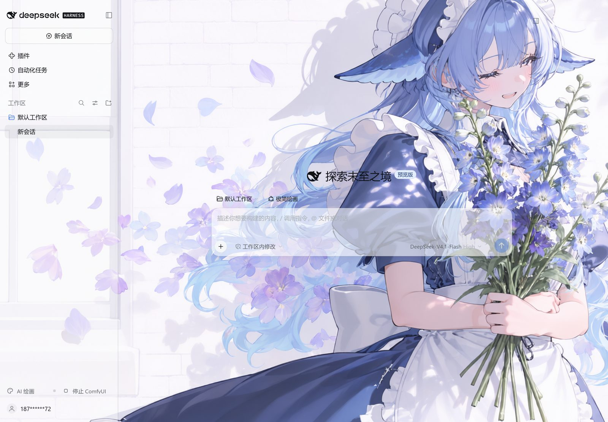
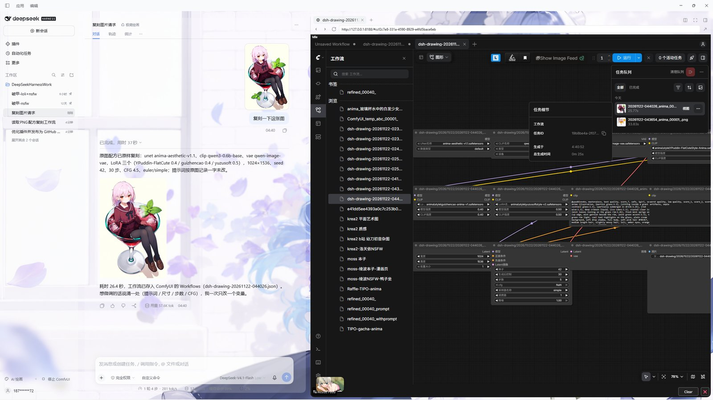

[English](README.md) | 简体中文

# 绘兼容

> 让 DeepSeek Harness 通过 ComfyUI 服务做本地 AI 绘画。

DeepSeek Harness（DSH）本身没有出图能力。这个 bundle 提供 12 个 `drawing_*` 工具，用 HTTP 协议驱动本机的 ComfyUI；同时在侧边栏加一个入口，点一下就能在 DSH 右栏打开 ComfyUI 画布。工具能查服务状态、列出真正可用的模型、按模型族读取提示词指南、批量或图生图出图、查看/干预队列、查最近记录、跑已保存的工作流，以及从 ComfyUI 生成的 PNG 里读回配方。英文显示名 **Drawing tools**，中文显示名 **绘画工具**。

只装这一个 bundle 就能同时得到三样东西：12 个工具、侧边栏入口，以及 **极简绘画** agent 预设（预设 id `drawing-minimal`，会出现在新建会话的预设列表里）。预设不需要再单独装第二个包。



## 为什么用它

大多数 ComfyUI 桥接只给模型一个 `generate` 调用，剩下的都留给你。这个 bundle 面向一台它没见过的机器，也面向一张真的想画完的图。

| | dsh-drawing-tools | 普通 ComfyUI 桥接 |
| --- | --- | --- |
| 懂模型 | 五个模型族的真实尺寸/步数/CFG、采集到的触发词、各族默认参数 | 全靠模型猜 |
| 缺文件 | 读 PNG 配方，去 Civitai / Hugging Face（含镜像）搜索，规范化安装，校验哈希 | 直接失败 |
| 可复现 | 每次运行的 UI 工作流写进 ComfyUI 并嵌进 PNG | 一次性图 |
| 可迁移 | 不预设路径；采用 ComfyUI 自报路径；探测显卡与启动命令 | 写死路径 |
| 可救回 | 读旧 ComfyUI PNG，重建整张图 | 从头再来 |

## 快速开始 / Quick start

**这是什么。** 一个把本机 ComfyUI 变成绘画 agent 的 DeepSeek Harness 插件包。装一次同时得到 12 个 `drawing_` 工具、一个打开 ComfyUI 画布的侧边栏入口（桌面版进右栏，网页版新开标签页），以及 **极简绘画** agent 预设。它只通过 HTTP 访问你自己的 ComfyUI，不含任何模型、不上传任何数据。

**What it is.** A DSH bundle that turns a local ComfyUI into a drawing agent; one install gives twelve `drawing_` tools, a sidebar canvas entry and the Minimal drawing preset.

**安装。**
1. 装好 ComfyUI（任意显卡；`drawing_status` 会给出适配的构建与启动参数）并启动，默认 `http://127.0.0.1:8188`。没模型时用 `drawing_download` 从 Civitai / Hugging Face 搜索安装。
2. 加进一个 DSH profile——桌面版：**设置 → 插件**；命令行：
   ```sh
   git clone https://github.com/LuosuQWQ/dsh-drawing-tools.git
   dsh plugin --profile <profile> add link:<本地绝对路径>/dsh-drawing-tools
   ```
3. **重启 DSH**，新建会话选 **极简绘画**。
4. 先 `drawing_status`；ComfyUI 未配置自动启动时用 `drawing_setup({ action: 'detect' })` / `apply`。

内置族指南为中文（供 agent 读取）；英文目录见 [guides/README.en.md](guides/README.en.md)。

> **第一次使用请先读。** 装好 bundle 后重启 DSH，新建会话并选择 **极简绘画** 预设。这个预设就是安装器：它会检查机器、告诉你哪种 ComfyUI 构建适合当前显卡，并在你允许后下载安装 ComfyUI、写好启动命令。它请求「完全权限」时请在该会话里授予——否则它无法写工作区之外的目录，也无法启动服务。如果是 agent 帮你装，它必须先告知你，再逐步汇报结果。



**给 agent。** 工具清单、配置键、凭据名、路径规则与验收步骤见 [AGENTS.md](AGENTS.md)。

## 画布怎么打开（所有情况）

侧边栏入口在各处都一样，但画布出现在哪里取决于 DSH 跑在哪里：

| 情况 | 行为 |
| --- | --- |
| 桌面客户端 | 在右栏打开一个原生浏览器标签页 |
| 用普通浏览器打开 DSH | 在新浏览器标签页打开 ComfyUI 地址（没有右栏可占） |
| 有右栏但会话表面没挂载 | 先重试右栏，失败后降级为新标签页，不再报错 |
| 浏览器拦截新标签页 | 弹提示说明被拦截；允许弹窗后重试 |
| ComfyUI 没启动 | 入口会按 `launch` 配置或探测结果把它拉起来，再开画布 |
| ComfyUI 不在 8188 或在外网 | 改 `config.origin`（或 `COMFY_ORIGIN`），画布和所有工具都跟随 |
| 根本没装 ComfyUI | `drawing_status` 会说明装什么、哪种构建适合当前显卡 |

## 截图



**1** **极简绘画** 预设：12 个 `drawing_` 工具，不带编辑器/网页工具，人格只在明确要求时出图。**2** 设置上方的 **AI 绘画** 入口：显示 ComfyUI 状态、可停止服务、可打开画布；底部 toast 会说明打开方式。



**3** 在桌面客户端里按 PNG 配方复刻：agent 读取内嵌工作流，保留模型、采样器与叠加的 LoRA，把原来的随机提示词换成固定描述后重跑，并把新图保存进 ComfyUI 的 Workflows 列表；右侧画布就是保存后的工作流，能看到 `LoraLoader` 链。


**4** 按叠加了多个风格 LoRA 的 PNG 配方复现的结果（anima-aesthetic-v1.1 + `luotianyi` / `guizhencao` / `yuzusoftstyle` / `YPuddin-FlatCute`，权重 0.4–0.9），1024×1536；配方跟着文件走，所以能精确重建。

## 功能

- 12 个 `drawing_*` 工具：状态、模型清单、族用法指南、出图（批量 / 图生图 / LoRA）、队列控制、历史记录、已保存工作流、PNG 配方解析。
- 一张图可叠多个 LoRA：传数组，按顺序各生成一个 LoraLoader 节点（MODEL 与 CLIP 都串起来），可分别控制 model/clip 强度。
- 每次生成在 ComfyUI 里可见：以 `dsh-drawing-tools` 客户端提交，UI 版工作流写进 ComfyUI 的 Workflows 列表，同一份工作流也嵌在 PNG 里，把图片拖回画布就能打开整张图。
- 四个模型族（classic、anima、krea2、moss），每族各有步数、CFG、采样器、调度器的推荐值。
- 内置按族整理的用法指南：提示词写法、分辨率、文字排版、常见坑，由 `drawing_guide` 读取；另有一份提示词模板库（9 个实测模板、负面词包、选族速查）。
- 侧边栏入口位于 Settings 上方，没启动时自动拉起 ComfyUI，并把画布打开：桌面版开在右栏的原生标签里；用浏览器直接打开 DSH（没有右栏）时改为新开一个浏览器标签页。
- 模型官方文档：`drawing_modeldoc` 从 Hugging Face / Civitai 抓取模型卡或说明（也可 import 本地 .md），存到 `<models>/.dsh-docs/<类别>/<slug>/` 并记录来源；`drawing_guide({ model })` 会先返回它，没有才回退族指南。安装时也会自动抓取。
- 每个模型文件都带 `usage` 字段：直接给出用它出图的调用方式（checkpoint 走 `classic`，四族走本族，其它扩散模型走 `generic` 并配伴生文件）。
- 缺模型可自助补齐：`drawing_download` 搜索 Civitai、装进 ComfyUI 对应目录、校验 SHA256 并报告落点；token 由宿主持有，不进提示词。
- 附带 **极简绘画** agent 预设：官方 `minimal` 的工具表加 12 个 `drawing_*` 工具，别的都没有（不带 web / todo / jobs / 文件读写 / 子 agent）。
- 聊天图片的配方可回溯：上传时就截下原始 PNG 里的 ComfyUI 文本块，因此 `drawing_pnginfo` 用消息里的 `sha256` 就能回答，原图删了也不影响。
- 一条命令启停本机 ComfyUI，日志与 pid 文件落在你指定的目录。

## 启动 ComfyUI

侧边栏入口和 `/start` 路由通过宿主行的 `launch` 配置启动 ComfyUI。该配置为空时，宿主会自动探测：ComfyUI 根来自配置的 `comfyRoot`、`COMFYUI_HOME`、ComfyUI 自报的 `models` 目录的上一级，或几个常见便携安装位置；再找 `main.py` 与解释器（`.ext/python.exe`、`python_embeded`、`venv`、`.venv`）。`drawing_status` 会说明用的是哪个来源。

探测失败（不常见布局）时：`drawing_setup({ action: 'detect' })` 看候选目录与失败原因，`drawing_setup({ action: 'apply', comfyDir: '<ComfyUI 目录>' })` 把 `command`/`args`/`cwd` 写进宿主行。显式 `launch` 配置始终优先于探测。

## 显卡与 ComfyUI 构建

这个 bundle 不预设 CUDA。`drawing_status` 会检测本机显卡（厂商、型号、显存），并直接打印适合它的构建与启动参数，所以不懂 ROCm / CUDA 的用户也能装对：

| 显卡 | 构建 | 常见附加参数 |
| --- | --- | --- |
| NVIDIA | CUDA（官方便携包默认就是） | `--use-pytorch-cross-attention` |
| AMD（Windows） | ROCm 版（推荐）或 DirectML 版 | `--use-quad-cross-attention`；只有 DirectML 版才加 `--directml` |
| AMD（Linux） | ROCm | `--use-quad-cross-attention` |
| Intel | IPEX（实验性） | `--use-ipex` |
| Apple Silicon | 官方 macOS 包 | 自动走 MPS |
| 无独显 | CPU | `--cpu`（很慢） |

显存也会影响建议：低于 6 GB 建议 `--lowvram`，低于 2 GB 建议 `--novram`。`scripts/start-comfyui.ps1` 会自动按厂商加同样的参数（`-ExtraArgs` 可覆盖，`-Cpu` 强制 CPU）。如果 ComfyUI 实际在 CPU 上跑，`drawing_status` 会明确警告。

## 运行要求

- DeepSeek Harness 0.2.x（开发时为 0.2.2-rc.5）。
- 一个正在运行、HTTP API 可访问的 ComfyUI，默认地址 `http://127.0.0.1:8188`。
- 你要用的模型族所需的模型文件。本包不含任何模型，`drawing_models` 只报告你的安装里真实存在的文件。
- 自带启动器与停止逻辑依赖 `tasklist`、`netstat`、`taskkill`，因此仅支持 Windows。工具本身只走 HTTP。
- 图内联展示走 DSH 自己的渲染：Markdown 里「百分号编码的本机路径」由鉴权文件路由取字节，`drawing_generate` 会为每张图返回这一行。不需要任何额外的图片插件。

## 安装

这是一个 DSH bundle，用 `plugin_manager` 安装：

```json
{ "action": "install_bundle", "target": "<path-to-checkout>" }
```

也可以写进 profile 的 `package.json`（Windows 上 profile 目录是 `$env:DSH_PROFILE_DIR`）再安装：

```json
{
  "dependencies": {
    "dsh-drawing-tools": "file:<path-to-checkout>"
  }
}
```

```bash
pnpm install
```

安装对当前 profile 全局生效。改动本包的 JavaScript 后需要重启 DSH：profile 的默认热重载只重新加载配置，已在运行的会话会继续使用启动时加载的模块。

**装上本 bundle 就同时得到 10 个工具、「极简绘画」agent 预设和侧边栏入口。** 工具以 `dsh-drawing-tools/tools` 导出，只出现在引用了这一行的预设里；本包自带的那行预设就是引用它（预设 id `drawing-minimal`）。`dsh-drawing-minimal` 已弃用，只作为兼容占位。

## 配置

bundle 只插入一行 Host 配置 `drawing-console`，也就是侧边栏入口。在 profile 的 patch 里覆盖它：

```yaml
- id: drawing-console
  name: dsh-drawing-tools
  config:
    origin: http://127.0.0.1:8188
    launch:
      enabled: true
      command: <comfyui-root>/.ext/python.exe
      args: [<comfyui-root>/main.py, --force-fp32]
      cwd: <comfyui-root>
      logDir: <path-for-logs>
      timeoutMs: 90000
```

| 字段 | 类型 | 默认值 | 说明 |
| --- | --- | --- | --- |
| `origin` | string | `http://127.0.0.1:8188` | ComfyUI API 基地址，入口与状态探测都用它。 |
| `launch.enabled` | boolean | 自动 | 只有在拿到了启动命令与工作目录时才自动启用；设为 `false` 可显式关闭。 |
| `launch.command` | string | `COMFYUI_PYTHON`，否则空 | 启动 ComfyUI 用的 Python 可执行文件。 |
| `launch.args` | string[] | `COMFYUI_MAIN`，否则空 | 传给 `main.py` 的参数；内置形式会加上 `--preview-method auto`。 |
| `launch.cwd` | string | `COMFYUI_HOME`，否则空 | ComfyUI 工作目录。 |
| `launch.logDir` | string | `COMFYUI_LOG_DIR`，否则临时目录 | 存放 `comfyui-<时间戳>.log` 与 `comfyui.pid` 的目录。 |
| `launch.timeoutMs` | number | `90000` | 启动时等待端口响应的上限。 |

bundle 里这几项启动路径默认留空，因此在你提供之前自动启动是关闭的。给 DSH 进程设置 `COMFYUI_PYTHON`、`COMFYUI_MAIN`、`COMFYUI_HOME` 三个环境变量，或直接填进这一行的字段，之后点侧边栏入口才会拉起 ComfyUI。不用启动器时设 `launch.enabled: false`，在 DSH 之外自行启动。

工具侧读取的是挂载它的那一行（预设里的 `drawing-tools`）的配置：

| 字段 | 类型 | 默认值 | 说明 |
| --- | --- | --- | --- |
| `origin` | string | `COMFY_ORIGIN`，否则 `http://127.0.0.1:8188` | ComfyUI API 基地址。 |
| `comfyRoot` | string | ComfyUI 自报 | ComfyUI 安装目录，工作流目录由它推导。自报值优先；本字段只在离线时兜底（环境变量不再参与）。 |
| `modelsRoot` | string | ComfyUI 自报 | 用于文件大小与目标目录提示的模型树。自报值优先；本字段只在离线时兜底（环境变量不再参与）。 |
| `outputDir` | string | 内置路径 | 生成的 PNG 与同名 `.json` 落在哪里。 |
| `apiWorkflowsDir` | string | `<comfyRoot>/api-workflows` | `drawing_workflow` 列出并运行的 API 格式工作流目录。 |
| `uiWorkflowsDir` | string | `<comfyRoot>/user/default/workflows` | `drawing_pnginfo` 存 UI 格式图的位置，ComfyUI 的 Workflows 面板可直接打开。 |
| `timeoutSeconds` | number | `600` | 出图默认等待上限，取值限制在 30–3600。 |

与启动路径一样，`comfyRoot`、`modelsRoot`、`outputDir` 的内置默认值只对应一种本地布局，换机器时请显式设置。

## 模型来源与安装规范

从 PNG 读出的工作流会先做审计：`drawing_pnginfo` 返回工作流形态、节点清单（类型与数量）以及图里引用的每个模型文件，并标注「已安装 / 缺失」；ComfyUI 离线时标注为「无法核对」。

缺的文件交给 **`drawing_download`** 处理，来源与安装规则固定：

| 步骤 | 作用 |
| --- | --- |
| `action: "search"` | 同时查 Civitai（公开 JSON API）与 Hugging Face（models API），`source` 可限定单一来源。Civitai 结果带版本 id、文件名、大小、SHA256；HF 结果带仓库 id、下载量与点赞。 |
| `action: "files"` | 列出某个 HF 仓库里的模型文件，带大小与 LFS SHA256。 |
| `action: "find"` | 通过 DSH 的 web 服务做泛网搜索，**只返回链接**，不会从任意站点自动下载。 |
| `action: "download"` | 按下面的规范安装一个文件。 |

搜索结果和下载结果都会按尝试顺序列出每个站点的成败（例如 `huggingface.co ✗ fetch failed → hf-mirror.com ✓`），某个站点失败会立刻记录并继续下一站，不会中断搜索。

每个来源有主站 + 备用站：Civitai 先试 `civitai.com`，失败退 `civitai.red`；Hugging Face 先试 `huggingface.co`，失败退 `hf-mirror.com`。只在网络失败或 5xx 时切换；401/403 属于凭据问题，直接报告而不换站重试。

安装规范（都在代码里强制，不靠提示词）：

装完之后怎么用，按类别分：**checkpoint** 走 `classic`（SD1.5 / SDXL / Pony 都能用 `CheckpointLoaderSimple` 加载）；**LoRA** 通过 `lora` 参数加到任意族；**VAE / text encoder** 只是零件，不能单独出图；其它**扩散模型**走 `family: 'generic'`，必须显式给 `textEncoder` 与 `vae`（`.gguf` 自动用 GGUF 加载器）。`drawing_models` 在每个文件的 `usage` 字段里写明这一点，`drawing_download` 装完也会直接给出用法。

- **按类别落目录**：`lora`→`loras`、`checkpoint`→`checkpoints`、`diffusion_model`→`diffusion_models`、`vae`→`vae`、`text_encoder`→`text_encoders`、`controlnet`→`controlnet`、`embedding`→`embeddings`、`upscale_model`→`upscale_models`、`clip_vision`→`clip_vision`。根目录来自 ComfyUI 自报或 `config.modelsRoot`，从不猜。
- **多模型根**：ComfyUI 用 `extra_model_paths.yaml` 把模型分散到多个目录时，文件大小与 LoRA 核对会遍历全部自报目录；安装仍落到该类别的主目录（第一个）。
- **文件名**保留可读形式（中文、空格、点号），但去掉路径、控制字符与 Windows 禁用字符；缺少模型扩展名时按类别补上；超过 120 字符截断，避免 Windows 路径超限。
- **不覆盖**：同名且非空的文件直接报告「已存在」并跳过；安装过程中出现同名冲突则改为 `name-2.safetensors`。
- **原子写入**：先落 `.part`，SHA256 校验通过后才改名；下载失败或取消会删掉半截文件。
- **元数据**：从 Civitai 安装会记录 `trainedWords`、`triggerAlternatives`（作者写的 `a | b` 备选）、`triggerHints`（model card 里的触发说明）、`baseModel`、标签、模型名与页面链接；从 Hugging Face 安装会记录 tags、pipeline 与 `instance_prompt`。一组词要一起用，备选是二选一，提示是作者的用法说明。`drawing_models` 按文件显示，`drawing_pnginfo` 会把它附在配方需要的文件上，下载结果里也会重复触发词。没有触发词时按族指南写提示词。
- **来源记录**：每次安装写 `<models>/.dsh-install/<目录>/<文件>.json`，含来源、URL（token 已脱敏）、类别、SHA256、字节数与时间，便于回溯与卸载。
- **凭据**：Civitai 用 `CIVITAI_TOKEN`，Hugging Face 用 `HF_TOKEN`，都走 DSH 凭据库，环境变量兜底。任何工具参数都不接受 token。

## 复刻测试样例

`test/fixtures/anima-cam-recipe.png` 是一张自带 ComfyUI API 工作流的 PNG，用来验证「看图 → 读配方 → 复刻」这条链路。像素缩到 768×1152 以控制仓库体积，配方里的尺寸仍是原始的 1024×1536。


```js
// 1. 读配方：模型 / 三个风格 LoRA / seed / 步数 / CFG / 尺寸
drawing_pnginfo({ path: 'test/fixtures/anima-cam-recipe.png' })
// 2. 缺哪个文件补哪个（返回里的 missing 会写清）
drawing_download({ action: 'search', query: '<缺失的 LoRA 名>', kind: 'lora' })
// 3. 按原配方出图
drawing_generate({ family: 'anima', model: 'anima-aesthetic-v1.1.safetensors', prompt: '...', lora: [...], seed: 11111, steps: 30, cfg: 4.5, width: 1024, height: 1536 })
```

这张图需要 `anima-aesthetic-v1.1` + `qwen3-0.6b-base` + `qwen-image-vae` 和三个风格 LoRA（YPuddin 0.4 / guizhencao 0.5 / yuzusoft 0.6）。缺文件时 `drawing_pnginfo` 会把它们列进 `missing`，`drawing_generate` 会明确指出缺哪一个。

## Civitai 凭据

`drawing_download` 只在模型需要登录（以及 Civitai 拒绝匿名搜索）时才用到 token。token 不是配置、也不会进模型上下文：

- 在 **设置 → AI 绘画** 里填一次：面板把它写进 DSH 的凭据库，引用名 `CIVITAI_TOKEN`。值只在宿主之间传递，不回显；之后的读取只报告「是否已配置 / 来源 / 掩码」。
- 或者设置环境变量 `CIVITAI_TOKEN` 后重启 DSH。已保存的值优先于环境变量，这与 DSH 的凭据规则一致。
- 旧版本留下的明文 `~/.dsh/civitai_token` 不会被直接读取；面板提供一次 **从旧文件导入**，导入后原文件保留，由你自行删除。
- 工具参数里没有任何 token 字段。不要把 token 贴进对话：那会进入会话记录。错误信息在到达模型前会做脱敏（`token=***`、`Bearer ***`）。
- token 只发给官方域（`civitai.com` / `huggingface.co`）。连不上退到 `civitai.red`、`hf-mirror.com` 这类第三方镜像时不会附带凭据；镜像因此被 401 拒绝时，报错会说明是"没有把 token 发过去"，而不是让你重填。

## 输出布局与路径规范

生成图统一落在 `outputDir` 下：

```
<outputDir>/<年>/<月>/<日>/<时分秒>_<族>_<模型slug>_s<seed>_<序号>.png
<outputDir>/<年>/<月>/<日>/<同名>.png.json
<outputDir>/index.jsonl
```

- 文件名可读、可排序，含族、模型片段、seed 与批次序号；同名不覆盖，冲突时自动加 `-2`。
- 每张图旁有同名 JSON（完整配方），根目录的 `index.jsonl` 追加一行总记录，所有生成可在一处检索。
- `outputDir` 会规范化：展开 `~`、相对路径按工作目录解析、去掉尾部分隔符。
- ComfyUI 自己那份放在 `<ComfyUI output>/dsh-drawing/<年>/<月>/<日>/`，它的 output 根目录不会被图片平铺。
- 旧图留在原位，只有新生成用这套布局。

ComfyUI 运行时自报的路径（`/internal/folder_paths`）优先于配置，所以换过安装位置或全新安装都能直接用；`drawing_status` 会打印对账结果并在不一致时警告，`drawing_paths({ action: 'adopt' })` 可把真实路径写回配置。

## 路径约定

- **输入路径**以会话目录为基准。插件通过 DSH 的 `workingDirectory` 服务取当前目录（拿不到时退回会话头里记录的 cwd），所以相对路径的含义是"从这个会话的工作目录出发"。
- **资源名与路径用不同参数**：`initImage` 只接本机路径，`initImageName` 只接 ComfyUI input 目录里已有的文件名；`drawing_workflow` 用 `path` 或 `name`；`drawing_pnginfo` 用 `sha256`、`name` 或 `path`。同时给两个会直接报错（不再"谁优先"），给出的路径不存在也会报错（不再静默当文件名重试）。
- **输出统一是绝对路径**：生成的 PNG 落在 `outputDir`，保存的配方落到 ComfyUI 自己的 workflow 目录；写入用独占创建，并发保存会得到 `name-2.json` 而不是互相覆盖。
- **按名字找图默认只在本地目录**：`drawing_pnginfo({ name })` 搜输出目录、会话目录和 ComfyUI 的 `input`/`temp`；要连桌面和下载一起搜，传 `searchUserDirs: true`。
- **这不是沙箱**：宿主半会读取你交给它的任意本机路径（图生图与配方读取就是这么工作的），只把它指向你愿意被读取的文件。

## 使用

### 工具

| 工具 | 作用 | 关键参数 |
| --- | --- | --- |
| `drawing_status` | 报告 ComfyUI 是否在线、版本、显存总量与可用量、队列长度，以及每族可用的模型。 | 无 |
| `drawing_models` | 列出 ComfyUI 真正能加载的模型文件，含所属族、大小与推荐采样参数。 | `kind`：`checkpoints`、`diffusion_models`、`text_encoders`、`vae`、`loras` |
| `drawing_guide` | 返回某一族的用法指南：提示词格式、分辨率、文字排版、参数、常见坑；`family: "prompt-patterns"` 返回提示词模板库。不传 `family` 返回索引。 | `family` |
| `drawing_generate` | 出一张或多张图，或做图生图，可带 LoRA；图落到输出目录并返回绝对路径。 | `prompt`、`family`、`model`、`width`、`height`、`steps`、`cfg`、`sampler`、`scheduler`、`seed`、`batch`、`lora`、`initImage`、`initImageName`、`textEncoder`、`vae`、`clipType`、`denoise`、`timeoutSeconds` |
| `drawing_queue` | 查看队列、中断正在跑的任务、清空尚未开始的任务。 | `action`：`status`、`interrupt`、`clear` |
| `drawing_history` | 返回最近完成的生成记录，带每张图的本地路径。 | `limit`（1–50，默认 10） |
| `drawing_workflow` | 列出或运行 `api-workflows` 目录里的 API 格式工作流图。 | `action`：`list`、`run`；`name`、`path`、`timeoutSeconds` |
| `drawing_setup` | 探测 ComfyUI 安装与 Python（`detect`），或把结果写进宿主行的 `launch` 配置（`apply`），让侧边栏入口与 start 路由能启动 ComfyUI。 | `action`、`comfyDir`、`python` |
| `drawing_modeldoc` | 抓取（fetch）、导入（import）、查看（show）或列出（list）模型官方文档，存于 `<models>/.dsh-docs`；`drawing_guide({ model })` 读取它。 | `action`、`model`、`kind`、`repo`、`versionId`、`path` |
| `drawing_paths` | 对比「配置里的路径」与「ComfyUI 运行时自报的路径」，指出不一致与不存在的目录；`adopt` 把真实路径写回插件配置。 | `action` |
| `drawing_download` | 查找并安装模型：`search`（Civitai + Hugging Face）、`files`（列 HF 仓库文件）、`find`（泛网搜索，只给链接）、`download`（规范化安装）。token 只存在宿主凭据库里。 | `action`、`source`、`query`、`kind`、`type`、`nsfw`、`limit`、`repo`、`file`、`revision`、`modelVersionId`、`downloadUrl`、`fileName`、`sha256` |
| `drawing_pnginfo` | 从 PNG 读回 ComfyUI 配方：模型、LoRA、seed、步数、CFG、采样器、正负提示词。 | `sha256`、`name`、`path`、`save`、`searchUserDirs` |

### 模型族

| 族 | 模型类型 | 默认参数（步数 / CFG / 采样器 / 调度器） | 适合 |
| --- | --- | --- | --- |
| `classic` | SD 1.5 checkpoint | 25 / 7 / `euler` / `normal` | 快速草稿、通用兜底。 |
| `anima` | Anima 2B，自带文本编码器与 VAE | 30 / 4 / `euler` / `simple` | 动漫、插画、角色。turbo 变体降到 8 步、CFG 1。 |
| `krea2` | Krea-2 Turbo 12B（GGUF） | 8 / 1 / `euler` / `simple` | 写实、电影感、强风格化；四族里最慢。 |
| `moss` | MOSS-Image 5B | 25 / 2.5 / `er_sde` / `simple` | 准确的中英文字排版、海报、示意图。 |

不传 `steps`、`cfg`、`sampler`、`scheduler`、`width` 时使用该族推荐值。具体某个文件适用什么值看 `drawing_models`，某族该怎么写提示词看 `drawing_guide`；指南与工具返回冲突时以工具返回为准。

一次最小调用：

```json
{
  "name": "drawing_generate",
  "arguments": {
    "prompt": "a red fox sitting in a snowy forest at dusk, soft rim light, detailed fur, cinematic",
    "family": "anima",
    "width": 768,
    "height": 768,
    "seed": 11
  }
}
```

每张图落在 `outputDir` 下的日期目录里，旁边有一个同名 `.json`，记录参数与 ComfyUI 的 `promptId`。

### 侧边栏入口

入口在左侧边栏底部、Settings 正上方，文案为「AI 绘画」（英文界面是 **AI drawing**）。状态圆点为绿色表示 ComfyUI 在运行，灰色表示未运行，琥珀色闪烁表示正在启动；状态每 12 秒轮询一次，页面隐藏时暂停。点一下会先探测服务、需要时自动拉起，然后调 `ctx.sidebarRight.openTab('browser', …)` 在右栏的原生浏览器标签里打开画布。服务在线时旁边会多出「停止 ComfyUI」一行，点它停掉服务并释放显存。

## 实现机制

工具是纯 Node 代码，通过 HTTP 与 ComfyUI 交互：`/object_info` 取模型清单，`/system_stats` 与 `/queue` 取状态，`/prompt` 提交工作流，轮询 `/history/<id>` 取结果，用 `/view` 下载图片，图生图输入走 `/upload/image`。每族对应一张工作流图，以 ComfyUI 的 API 格式提交；生成结果只落盘、不进模型上下文。

Host 半提供入口需要的配置、状态、启动、停止、日志路由，并在 attachments 服务归一化图片之前包了一层保存方法：把 PNG 里的 `prompt`、`workflow`、`parameters` 文本块按归一化后的附件 id（`sha256:…`）存进 `<DSH_HOME>/drawing-pnginfo/`。所以聊天里发过的图，`drawing_pnginfo` 不传路径也能读配方。

## 已知限制

- 工作流必须是 ComfyUI 的 API 格式。UI 编辑器导出的图会被拒绝，请用 **Export (API)** 导出后放进 `api-workflows`。
- 不附带模型、LoRA、embeddings、放大模型。缺文件需要先装进 ComfyUI 再出图。
- 建议串行出图；`batch` 大于 1 或分辨率过大容易耗尽显存。
- 自动启停只支持 Windows，且停止只针对本 bundle 记录的 pid 或监听目标端口的 `python.exe`。
- 配方截取只覆盖 bundle 生效之后上传的图片。旧文件、截图、被重新编码过的图都不含 ComfyUI 元数据。
- 工具描述与按族指南目前是中文写的；英文读者可对照本仓库的英文 README 理解行为。

## 换一台机器怎么用

这个包不假设作者的磁盘布局或显卡型号；它只假设**某个 ComfyUI 在配置的 origin 上应答**。

1. **自己装并启动 ComfyUI**（任意目录、任意平台）。插件不带任何默认安装目录或模型目录，不会指向你机器上不存在的路径；ComfyUI 一起来它读到的就是真实路径。它要监听 `127.0.0.1:8188`，否则就改 `origin`（插件行 config 或环境变量 `COMFY_ORIGIN`）。Windows 可用 `scripts/start-comfyui.ps1`，macOS/Linux 可用 `scripts/start-comfyui.sh`，或者直接 `python main.py`。
2. **先做一次体检**：`drawing_status` 会报告版本、设备、显存、模型目录是从哪来的、有没有配自动启动、每个族有哪些文件。连不上时会说清缺什么、下一步怎么做，而不是抛一个莫名其妙的错。
3. **给想用的族补模型**，然后出图。

不预设任何 ComfyUI / 模型路径。解析顺序：配置或环境变量优先，其次问运行中的 ComfyUI 自己的目录表（`/internal/folder_paths`，缓存 1 分钟），两者都没有就是**未知**——不存在「默认路径猜错」这回事。`drawing_status` 会说明用的是哪种来源；未知只会影响文件大小、本地找图与把配方存进 ComfyUI 目录，不影响出图。

| 缺什么 | 还能用 | 会降级 |
| --- | --- | --- |
| origin 上没有 ComfyUI | `drawing_guide`；`drawing_status` 会说明缺什么 | 出图、队列、历史、工作流全部不可用 |
| 没配 `comfyRoot`/`modelsRoot`，ComfyUI 也报不出目录 | 模型清单（名字来自 ComfyUI） | 文件大小、ComfyUI `input`/`temp` 下的本地找图、把配方存进 ComfyUI 目录 |
| 没配 `launch` | 侧边栏能打开 ComfyUI 画布 | 自动拉起 ComfyUI |
| 旧版 ComfyUI 没有 `/internal/folder_paths` | 所有走 HTTP 的功能 | 自动发现路径（需要显式配置） |

模型名不再写死在调用链里：省略 `model` 会选这台机器上该族真实存在的第一个文件；缺 text encoder / VAE 时会报错并指出该放进哪个目录。

## 开发

`npm test` 跑下面 4 个离线套件；其余是从包目录用 Node 直接跑的独立脚本，需要 ComfyUI 在线：

```bash
node test/package-contract.mjs # 离线：客户端模块 id、exports 与 slot 注册跟包名一致
node test/offline-contract.mjs # 离线：工具定义、模型族、指南可达性、清单干净
node test/guides.mjs          # 离线：四族指南可读、结构完整
node test/pnginfo.mjs         # 离线：PNG 配方解析与捕获记录查询
node test/capture.mjs         # 离线：Host 捕获钩子，加载已安装的 Cordis 构建
node test/check-connection.mjs    # 需要 ComfyUI：状态与模型清单
node test/tools-smoke.mjs         # 需要 ComfyUI：12 个工具端到端
node test/generate.mjs anima      # 需要 ComfyUI：单族出一张图，族可选 classic|anima|krea2|moss
node test/smoke-extras.mjs        # 需要 ComfyUI：批量、图生图、队列、历史、工作流
node test/timeout-interrupt.mjs   # 需要 ComfyUI：超时返回 promptId 后中断
node test/verify-variants.mjs     # 需要 ComfyUI：族变体默认参数
```

需要服务的测试读 `COMFY_ORIGIN`，默认 `http://127.0.0.1:8188`；`npm test` 只跑离线套件（包契约、离线契约、指南、PNG 配方）。

## 许可证

MIT，见 [LICENSE](LICENSE)。
